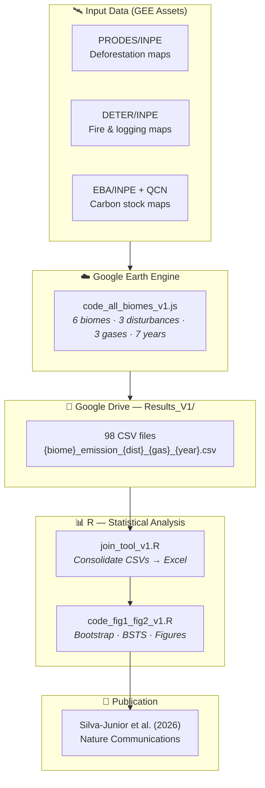

<div align="center">


<br/>

# 🌿 Brazil National FREL
### Emissions from Deforestation and Forest Degradation

<br/>

> **Silva-Junior, C. H. L. et al. (2026)**
> *Increased deforestation and forest degradation jeopardize Brazil's REDD+ results in 2022*
> **Nature Communications**

<br/>

</div>

---

## 🌎 Overview

This repository provides the full computational pipeline used to replicate **Brazil's National Forest Reference Emission Level (FREL)** methodology and quantify greenhouse gas (GHG) emissions from deforestation and forest degradation across all six Brazilian biomes for 2017–2023.

The analysis follows the methodology submitted by Brazil to the **UNFCCC** and assessed under the **REDD+ results-based payments** framework, covering three disturbance types:

| Disturbance | Abbreviation | Biomes |
|---|---|---|
| Deforestation | `def` | All 6 biomes |
| Forest fire | `fire` | Amazon only |
| Unplanned selective logging | `sl` | Amazon only |

Greenhouse gases quantified: **CO₂**, **CH₄** (×GWP 28), and **N₂O** (×GWP 265), per IPCC AR5.

---

## 🗺️ Study Biomes

Brazil's six biomes are modelled individually, each with its own carbon dataset, disturbance types, and combustion parameters:

<br/>

<div align="center">


</div>

<br/>

| Parameter | 🌳 **Amazon** | 🌾 **Cerrado** | 💧 **Pantanal** | 🌿 **Pampa** | 🏜️ **Caatinga** | 🌲 **Atlantic Forest** |
|:---|:---:|:---:|:---:|:---:|:---:|:---:|
| **Export prefix** | `amz` | `cerr` | `pan` | `pam` | `caa` | `ma` |
| **Deforestation** | ✅ CO₂ CH₄ N₂O | ✅ CO₂ CH₄ N₂O | ✅ CO₂ | ✅ CO₂ | ✅ CO₂ | ✅ CO₂ |
| **Fire** | ✅ CO₂ CH₄ N₂O | — | — | — | — | — |
| **Selective logging** | ✅ CO₂ | — | — | — | — | — |
| **Carbon data** | QCN + EBA/INPE | QCN | QCN | QCN | QCN | QCN |
| **Combustion fraction** | 0.368 | 0.379 | — | — | — | — |
| **PRODES classes** | >625 ha + <625 ha | >625 ha | >625 ha | >625 ha | >625 ha | >625 ha |
| **Annual exports** | 7 files/yr | 3 files/yr | 1 file/yr | 1 file/yr | 1 file/yr | 1 file/yr |

> **Total outputs:** 49 (Amazon) + 21 (Cerrado) + 7 × 4 (simple biomes) = **98 CSV files** per full run.

---

## 📁 Repository Structure

```
Brazil-National-FREL/
│
├── 📂 codes/
│   ├── 🌐 code_all_biomes_v1.js               ← GEE unified script (all 6 biomes)
│   └── 📊 code_fig1_fig2_v1.R                 ← Publication figures (R)
│
├── 📂 results/
│   ├── 🔧 join_tool_(gee_export_results)_v1.R ← Consolidates CSVs → Excel
│   └── 📂 Brazil-National-FREL-Results_V1/
│       ├── 📋 0_brazil_national_frel_results_v1.xlsx  ← Consolidated results
│       └── 📄 {biome}_emission_{dist}_{gas}_{year}.csv ← Raw outputs (98 files)
│
├── 📂 data/
│   └── 📝 dataset_assets_gee.txt              ← GEE asset paths for all datasets
│
└── 📄 README.md
```

### Script descriptions

#### `codes/code_all_biomes_v1.js` — Unified GEE Script

Single script that processes all six biomes in one run. Configurable via a dedicated block at the top — change `START_YEAR`, `END_YEAR`, or `EXPORT_FOLDER` and the entire script adapts automatically:

```javascript
var START_YEAR    = 2017;         // First year (inclusive)
var END_YEAR      = 2023;         // Last year  (inclusive)
var EXPORT_FOLDER = 'Results_V1'; // Google Drive destination
```

#### `codes/code_fig1_fig2_v1.R` — Publication figures
R script that reads the consolidated Excel file and produces:
- **Figure 1** — Bootstrap analysis of emission differences (ΔE) with 95% CI
- **Figure 2** — Bayesian Structural Time Series (BSTS) forecast

#### `results/join_tool_(gee_export_results)_v1.R` — Results consolidator
Reads all 98 CSV files exported by GEE, parses the filename to extract metadata (biome, disturbance, gas, year), and writes a single consolidated Excel file with per-state emission values.

---

## ⚙️ Analysis Workflow



---

## 📊 Output File Naming Convention

Every CSV exported by the GEE script follows a standardised pattern:

```
{biome}_emission_{disturbance}_{gas}_{year}.csv
```

| Segment | Values | Example |
|---|---|---|
| `{biome}` | `amz` `cerr` `pan` `pam` `caa` `ma` | `amz` |
| `{disturbance}` | `def` `fire` `sl` | `fire` |
| `{gas}` | `co2` `ch4` `n2o` | `co2` |
| `{year}` | `2017` … `2023` | `2022` |

**Examples:**

| File | Biome | Disturbance | Gas | Year |
|---|---|---|---|---|
| `amz_emission_fire_co2_2022.csv` | 🌳 Amazon | Fire | CO₂ | 2022 |
| `amz_emission_sl_co2_2019.csv` | 🌳 Amazon | Selective logging | CO₂ | 2019 |
| `amz_emission_def_ch4_2020.csv` | 🌳 Amazon | Deforestation | CH₄ | 2020 |
| `cerr_emission_def_n2o_2021.csv` | 🌾 Cerrado | Deforestation | N₂O | 2021 |
| `pan_emission_def_co2_2023.csv` | 💧 Pantanal | Deforestation | CO₂ | 2023 |
| `ma_emission_def_co2_2022.csv` | 🌲 Atlantic Forest | Deforestation | CO₂ | 2022 |

Each CSV contains **per-state** emission sums (t CO₂e). The `sum` column holds the value; `NM_UF` = state name; `Bioma` = biome name.

---

## 🛰️ GEE Datasets

All data are accessed as GEE assets (no local download required):

| # | Dataset | Use | GEE Asset |
|---|---|---|---|
| 1 | PRODES — deforestation >6.25 ha | Deforestation mask | `projects/ee-ipam/assets/REDD/prodes_brasil_2023` |
| 2 | PRODES — deforestation <6.25 ha | Small-patch deforestation (Amazon) | `projects/ee-ipam/assets/CCAL/DATASETS/PRODES/yearly_deforestation_smaller_than_625ha_biome` |
| 3 | Managed Forest Lands | Fire mask (Amazon) | `projects/ee-ipam/assets/Managed_Land_Brazil` |
| 4 | Biomes boundary (IBGE 1:250k) | Spatial clip | `projects/mapbiomas-workspace/AUXILIAR/biomas_IBGE_250mil` |
| 5 | Ancient Forest Vegetation Map | Forest mask | `projects/ee-ipam/assets/CCAL/DATASETS/UKPact_MRV/brazil_pret_vegetation_qcn_v2` |
| 6 | Carbon AGB — Amazon (EBA/INPE, 30 m) | Carbon stock | `projects/ee-ipam/assets/CCAL/DATASETS/FREL/EBA_AB_30m` |
| 7 | Carbon BGB — Amazon (EBA/INPE, 30 m) | Carbon stock | `projects/ee-ipam/assets/CCAL/DATASETS/FREL/EBA_BB_30m` |
| 8 | Carbon Deadwood — Amazon (EBA/INPE, 30 m) | Carbon stock | `projects/ee-ipam/assets/CCAL/DATASETS/FREL/EBA_DW_30m` |
| 9 | Carbon Litter — Amazon (EBA/INPE, 30 m) | Carbon stock | `projects/ee-ipam/assets/CCAL/DATASETS/FREL/EBA_LI_30m` |
| 10 | QCN 30m — 4th National GHG Inventory | Carbon stock (all biomes) | `projects/mapbiomas-workspace/SEEG/2022/QCN/QCN_30m_BR_v2_0_1` |
| 11 | Selective logging map — annual | Logging disturbance | `…/DeterAnoProdes_{year}_cs_disordered` |
| 12 | Fire map — annual (Amazon) | Fire disturbance | `…/DeterAnoProdes_{year}_fire` |
| 13 | States + Biomes boundary | Aggregation regions | `projects/ee-ipam/assets/BR_UF_Biomas` |

---

## ⚗️ Methodology Summary

Emissions are computed at 30 m resolution and aggregated by state × biome.

### Conversion factors

| Factor | Value | Source |
|---|---|---|
| C → CO₂ | 44 ÷ 12 ≈ **3.667** | Molecular weight ratio |
| GWP CH₄ | **28** | IPCC AR5 (100-year) |
| GWP N₂O | **265** | IPCC AR5 (100-year) |
| Amazon combustion fraction | **0.368** | Brazil National FREL |
| Cerrado combustion fraction | **0.379** | Brazil National FREL |
| CH₄ / N₂O emission ratio | **1 / 0.47** | Brazil National FREL |

### Amazon carbon stock update order (per year)

```
t₀ stocks  →  [Fire emissions]  →  updated stocks
           →  [Selective logging emissions]  →  updated stocks
           →  [Deforestation emissions]  →  updated stocks  →  t+1
```

> [!IMPORTANT]
> The Amazon script processes disturbances **sequentially within each year**. Changing the order would alter results. The unified script preserves this exact sequence.

---

## 🚀 How to Use

### Step 1 — Run the GEE emissions script

1. Open the [GEE Code Editor](https://code.earthengine.google.com)
2. Copy and paste `codes/code_all_biomes_v1.js`
3. Edit the configuration block at the top if needed:

```javascript
var START_YEAR    = 2017;
var END_YEAR      = 2023;
var EXPORT_FOLDER = 'Results_V1';
```

4. Click **Run** — all export tasks will appear in the **Tasks** panel
5. Click **Run** on each task (or use the GEE batch API) to start the exports to Google Drive

### Step 2 — Consolidate results (R)

```r
# Set file_path to where GEE exported the CSVs in Google Drive
source("results/join_tool_(gee_export_results)_v1.R")
# Output: results/Brazil-National-FREL-Results_V1/0_brazil_national_frel_results_v1.xlsx
```

### Step 3 — Generate publication figures (R)

```r
source("codes/code_fig1_fig2_v1.R")
# Output: Figure 1 (bootstrap ΔE) and Figure 2 (BSTS forecast)
```

> [!NOTE]
> Required R packages: `ggplot2`, `gridExtra`, `showtext`, `scales`, `bsts`, `dplyr`, `openxlsx`, `readr`

---

## 📖 Citation

If you use this code or data, please cite:

```bibtex
@article{silvajunior2026,
  author  = {Silva-Junior, Celso H. L. and others},
  title   = {Increased deforestation and forest degradation jeopardize
             {Brazil's} {REDD+} results in 2022},
  journal = {Nature Communications},
  year    = {2026},
  doi     = {}
}
```

---

## 📋 License

This project is licensed under the **GNU General Public License v4** — see the [LICENSE](LICENSE) file for details.

---

<div align="center">

Made with 🌿 for Brazilian forest conservation research

[](https://github.com/celsohlsj/Brazil-National-FREL)

</div>
