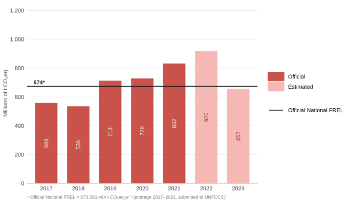

<div align="center">


[](http://dx.doi.org/10.5281/zenodo.3928660)
[](https://juleskreuer.eu/projekte/citation-badge/)

<br/>

# 🌿 Brazil National FREL
### Emissions from Deforestation and Forest Degradation

<br/>

> **Silva-Junior, C. H. L. et al. (2026)**
> *Increased deforestation and forest degradation counteract Brazil's REDD+ results in 2022*
> **Nature Communications**

<br/>

</div>

---

## 🌎 Overview

This repository provides the full computational pipeline used to replicate **Brazil's National Forest Reference Emission Level (FREL)** methodology and quantify greenhouse gas (GHG) emissions from deforestation and forest degradation across all six Brazilian biomes for 2017–2023.

The analysis follows the methodology submitted by Brazil to the **UNFCCC** and assessed under the **REDD+ results-based payments** framework, covering three disturbance types:

| Disturbance | Abbreviation | Biomes |
|---|---|---|
| Deforestation | `def` | All 6 biomes |
| Forest fire | `fire` | Amazon only |
| Disordered selective logging | `sl` | Amazon only |

Greenhouse gases quantified: **CO₂**, **CH₄** (×GWP 28), and **N₂O** (×GWP 265), per IPCC AR5.

---

## 📊 Key Results

<div align="center">



**Figure 1.** Annual GHG emissions from deforestation and forest degradation across all six Brazilian biomes (millions of t CO₂eq yr⁻¹). Blue = official FREL period (2017–2021); orange = estimated emissions (2022–2023). The horizontal line marks the Official National FREL (673.6 Mt CO₂eq yr⁻¹) submitted to the UNFCCC.

</div>

### Emissions vs. Official National FREL — post-baseline years

<!-- FREL_TABLE_START -->
| Year | Emissions (Mt CO₂eq) | FREL − Emissions (Mt CO₂eq) | FREL − Emissions (%) |
|:----:|---------------------:|----------------------------:|---------------------:|
| 2022 | 920.0 | **−246.4** | **−36.6 %** |
| 2023 | 656.9 | **+16.6** | **+2.5 %** |
<!-- FREL_TABLE_END -->

> FREL baseline = 673.6 Mt CO₂eq yr⁻¹ (average 2017–2021). **Positive** = emissions below the reference level (eligible for REDD+ results-based payments); **negative** = emissions exceeded the reference level.

> [!NOTE]
> The chart (`figures/fig1_emissions_overview.svg`) and the table above are **auto-regenerated** by GitHub Actions whenever [`data/fig1_data.csv`](data/fig1_data.csv) is updated and pushed. To add a new year, append a row to that CSV and push — no manual editing required.

---

## 🖥️ System Requirements

### Software dependencies

The published figures and statistics were produced with the versions below (see `codes/sessionInfo.txt` and `codes/sessionInfo_Figs1_4.txt`). Both figure scripts report at run time any difference from these versions (`check_environment()`).

| Software | Version used | Used by |
|---|---|---|
| Google Earth Engine | Browser-based (2024) | `code_all_biomes_v1.js` — free account: https://earthengine.google.com |
| R | 4.6.0 (2026-04-24) | all R scripts — https://cran.r-project.org |
| `bsts` | 0.9.11 (with `Boom` 0.9.16, `BoomSpikeSlab` 1.2.7) | Fig. 3 |
| `ggplot2` | 4.0.3 | Figs. 1–4 |
| `gridExtra` | 2.3 | Figs. 2–3 |
| `scales` | 1.4.0 | Figs. 1–4 |
| `ragg` | 1.5.2 | Figs. 1–4 (PNG export) |
| `systemfonts` | 1.3.2 | Figs. 1–4 (font detection) |
| `openxlsx` | 4.2.9 | Figs. 2–3 (Source Data export) |
| `rstudioapi` | 0.18.0 | Figs. 1–4 (working-directory detection) |
| `dplyr`, `readr`, `svglite` | any recent | `generate_fig1_svg.R`, `join_tool_(gee_export_results)_v1.R` |

> [!NOTE]
> Both analyses are exactly reproducible. The bootstrap test (Fig. 2) uses base R with `set.seed(42)`. The BSTS projections (Fig. 3) use the C++ Markov chain Monte Carlo sampler of `bsts`, which is seeded from the system clock unless a seed is supplied; `code_fig2_fig3_v1.1.0.R` therefore passes an explicit seed (`4200000 + replicate`) to `bsts()` and `predict()`, and two independent runs produce identical results. With other versions of `bsts`/`Boom`, the MCMC draws may differ slightly; to reproduce the published values exactly, install the versions listed above (e.g. `remotes::install_version("bsts", "0.9.11")`).

### Operating systems tested

- macOS 27.0, Apple silicon (aarch64) — final figures and statistics
- Windows 10 (64-bit)
- Ubuntu 22.04 LTS

### Non-standard hardware

No non-standard hardware is required. All GEE computations run on Google's cloud infrastructure. R scripts run on any standard desktop or laptop computer.

---

## ⚙️ Installation Guide

### Google Earth Engine

No local installation is required. GEE runs entirely in the browser.

1. Register for a free GEE account at https://earthengine.google.com (approval typically takes 1–2 business days)
2. Open the [GEE Code Editor](https://code.earthengine.google.com)
3. Copy and paste the contents of `codes/code_all_biomes_v1.js`

**Typical setup time:** < 5 minutes (after account approval).

### R

1. Install R (4.6.0 used for the paper) from https://cran.r-project.org
2. Install the required packages by running the following in an R console (the figure scripts also install any missing package automatically):

```r
install.packages(c(
  "ggplot2", "gridExtra", "scales", "bsts", "ragg", "systemfonts",
  "openxlsx", "rstudioapi", "dplyr", "readr", "svglite"
))
```

**Typical install time:** < 5 minutes on a standard desktop computer with internet connection.

---

## 🗺️ Study Biomes

Brazil's six biomes are modelled individually, each with its own carbon dataset, disturbance types, and combustion parameters:

<br/>

<div align="center">


</div>

<br/>

| Parameter | 🌳 **Amazon** | 🌾 **Cerrado** | 💧 **Pantanal** | 🌿 **Pampa** | 🏜️ **Caatinga** | 🌲 **Atlantic Forest** |
|:---|:---:|:---:|:---:|:---:|:---:|:---:|
| **Export prefix** | `amz` | `cerr` | `pan` | `pam` | `caa` | `ma` |
| **Deforestation** | ✅ CO₂ CH₄ N₂O | ✅ CO₂ CH₄ N₂O | ✅ CO₂ | ✅ CO₂ | ✅ CO₂ | ✅ CO₂ |
| **Fire** | ✅ CO₂ CH₄ N₂O | — | — | — | — | — |
| **Selective logging** | ✅ CO₂ | — | — | — | — | — |
| **Carbon data** | QCN + EBA/INPE | QCN | QCN | QCN | QCN | QCN |
| **Combustion fraction** | 0.368 | 0.379 | — | — | — | — |
| **PRODES classes** | >625 ha + <625 ha | >625 ha | >625 ha | >625 ha | >625 ha | >625 ha |
| **Annual exports** | 7 files/yr | 3 files/yr | 1 file/yr | 1 file/yr | 1 file/yr | 1 file/yr |

> **Total outputs:** 49 (Amazon) + 21 (Cerrado) + 7 × 4 (simple biomes) = **98 CSV files** per full run.

---

## 📁 Repository Structure

```
Brazil-National-FREL/
│
├── 📂 .github/workflows/
│   └── ⚙️  update_fig1.yml                    ← Auto-regenerates Figure 1 on CSV push
│
├── 📂 codes/
│   ├── 🌐 code_all_biomes_v1.js               ← GEE unified script (all 6 biomes)
│   ├── 📊 code_fig1_fig4_v1.0.1.R             ← Figs. 1 and 4 of the paper (R)
│   ├── 📊 code_fig2_fig3_v1.1.0.R             ← Figs. 2 and 3: bootstrap and BSTS (R)
│   ├── 📋 fig1_data.csv, fig4_data.csv        ← Input data of Figs. 1 and 4
│   ├── 📗 Source_Data.xlsx                    ← Source Data of the paper (Figs. 1–4, Tables 1–3)
│   ├── 🖼️  Fig1.png … Fig4.png                ← Published figures (600 dpi)
│   ├── 🧾 sessionInfo.txt, sessionInfo_Figs1_4.txt ← R session used for the figures
│   ├── 🔄 generate_fig1_svg.R                 ← Regenerates the README chart from data/fig1_data.csv
│   └── 🔄 update_readme_table.R               ← Updates the README table (GitHub Actions)
│
├── 📂 data/
│   ├── 📝 dataset_assets_gee.txt              ← GEE asset paths for all datasets
│   └── 📋 fig1_data.csv                       ← Figure 1 source data (editable)
│
├── 📂 figures/
│   └── 🖼️  fig1_emissions_overview.svg        ← Auto-generated chart (do not edit manually)
│
├── 📂 results/
│   ├── 🔧 join_tool_(gee_export_results)_v1.R ← Consolidates CSVs → Excel
│   └── 📂 Brazil-National-FREL-Results_V1/
│       ├── 📋 0_brazil_national_frel_results_v1.xlsx  ← Consolidated results
│       └── 📄 {biome}_emission_{dist}_{gas}_{year}.csv ← Raw outputs (98 files)
│
└── 📄 README.md
```

### Script descriptions

#### `codes/code_all_biomes_v1.js` — Unified GEE Script

Single script that processes all six biomes in one run. Configurable via a dedicated block at the top — change `START_YEAR`, `END_YEAR`, or `EXPORT_FOLDER` and the entire script adapts automatically:

```javascript
var START_YEAR    = 2017;         // First year (inclusive)
var END_YEAR      = 2023;         // Last year  (inclusive)
var EXPORT_FOLDER = 'Results_V1'; // Google Drive destination
```

#### `codes/code_fig1_fig4_v1.0.1.R` — Figures 1 and 4
Reads `fig1_data.csv` and `fig4_data.csv` (same folder) and produces:
- **Figure 1** — Official (2017–2021) and estimated (2022–2023) emissions under the National FREL
- **Figure 4** — Simulated modified National FREL (deforestation and degradation components)

#### `codes/code_fig2_fig3_v1.1.0.R` — Figures 2 and 3
Self-contained script (annual emissions embedded) that produces:
- **Figure 2** — Bootstrap deviation test of emission differences (ΔE), 10,000 replicates, 95% CI
- **Figure 3** — Bayesian Structural Time Series (BSTS) projections, 10,000 bootstrap-resampled series

When `Source_Data.xlsx` is in the same folder, the script writes the summary statistics and the 10,000 replicates of each figure into its `Fig2` and `Fig3` sheets.

Both scripts set the working directory to their own folder (RStudio *Source*, `source()` or `Rscript`), export PNG figures at 600 dpi, and check the R and package versions against those used for the paper.

#### `results/join_tool_(gee_export_results)_v1.R` — Results consolidator
Reads all 98 CSV files exported by GEE, parses the filename to extract metadata (biome, disturbance, gas, year), and writes a single consolidated Excel file with per-state emission values.

---

## 📊 Output File Naming Convention

Every CSV exported by the GEE script follows a standardised pattern:

```
{biome}_emission_{disturbance}_{gas}_{year}.csv
```

| Segment | Values | Example |
|---|---|---|
| `{biome}` | `amz` `cerr` `pan` `pam` `caa` `ma` | `amz` |
| `{disturbance}` | `def` `fire` `sl` | `fire` |
| `{gas}` | `co2` `ch4` `n2o` | `co2` |
| `{year}` | `2017` … `2023` | `2022` |

**Examples:**

| File | Biome | Disturbance | Gas | Year |
|---|---|---|---|---|
| `amz_emission_fire_co2_2022.csv` | 🌳 Amazon | Fire | CO₂ | 2022 |
| `amz_emission_sl_co2_2019.csv` | 🌳 Amazon | Selective logging | CO₂ | 2019 |
| `amz_emission_def_ch4_2020.csv` | 🌳 Amazon | Deforestation | CH₄ | 2020 |
| `cerr_emission_def_n2o_2021.csv` | 🌾 Cerrado | Deforestation | N₂O | 2021 |
| `pan_emission_def_co2_2023.csv` | 💧 Pantanal | Deforestation | CO₂ | 2023 |
| `ma_emission_def_co2_2022.csv` | 🌲 Atlantic Forest | Deforestation | CO₂ | 2022 |

Each CSV contains **per-state** emission sums (t CO₂e). The `sum` column holds the value; `NM_UF` = state name; `Bioma` = biome name.

---

## 🛰️ GEE Datasets

All data are accessed as GEE assets (no local download required):

| Dataset | Use |
|---|---|
| PRODES — deforestation >6.25 ha | Deforestation mask |
| PRODES — deforestation <6.25 ha | Small-patch deforestation (Amazon) |
| Managed Forest Lands | Fire mask (Amazon) |
| Biomes boundary (IBGE 1:250k) | Spatial clip |
| Ancient Forest Vegetation Map | Forest mask |
| Carbon AGB — Amazon (EBA/INPE, 30 m) | Carbon stock |
| Carbon BGB — Amazon (EBA/INPE, 30 m) | Carbon stock |
| Carbon Deadwood — Amazon (EBA/INPE, 30 m) | Carbon stock |
| Carbon Litter — Amazon (EBA/INPE, 30 m) | Carbon stock |
| QCN 30m — 4th National GHG Inventory | Carbon stock (all biomes) |
| Selective logging map — annual | Logging disturbance (Amazon) |
| Fire map — annual | Fire disturbance (Amazon) |
| States + Biomes boundary | Aggregation regions |

> Full GEE asset paths are listed in [`data/dataset_assets_gee.txt`](data/dataset_assets_gee.txt).

---

## ⚗️ Methodology Summary

Emissions are computed at 30 m resolution and aggregated by state × biome.

### Conversion factors

| Factor | Value | Source |
|---|---|---|
| C → CO₂ | 44 ÷ 12 ≈ **3.667** | Molecular weight ratio |
| GWP CH₄ | **28** | IPCC AR5 (100-year) |
| GWP N₂O | **265** | IPCC AR5 (100-year) |
| Amazon combustion fraction | **0.368** | Brazil National FREL |
| Cerrado combustion fraction | **0.379** | Brazil National FREL |
| Carbon to dry matter biomass | **1 / 0.47** ≈ 2.128 | Carbon fraction of dry biomass = 0.47 (Brazil National FREL) |

### Amazon carbon stock update order (per year)

```
t₀ stocks  →  [Fire emissions]  →  updated stocks
           →  [Selective logging emissions]  →  updated stocks
           →  [Deforestation emissions]  →  updated stocks  →  t+1
```

> [!IMPORTANT]
> The Amazon script processes disturbances **sequentially within each year**. Changing the order would alter results. The unified script preserves this exact sequence.

---

## 🚀 How to Use

### Step 1 — Run the GEE emissions script

1. Open the [GEE Code Editor](https://code.earthengine.google.com)
2. Copy and paste `codes/code_all_biomes_v1.js`
3. Edit the configuration block at the top if needed:

```javascript
var START_YEAR    = 2017;
var END_YEAR      = 2023;
var EXPORT_FOLDER = 'Results_V1';
```

4. Click **Run** — all export tasks will appear in the **Tasks** panel
5. Click **Run** on each task (or use the GEE batch API) to start the exports to Google Drive

> **Expected run time:** GEE script: 5–15 minutes (cloud-based; may vary with server load).

### Step 2 — Consolidate results (R)

```r
# Set file_path to where GEE exported the CSVs in Google Drive
source("results/join_tool_(gee_export_results)_v1.R")
# Output: results/Brazil-National-FREL-Results_V1/0_brazil_national_frel_results_v1.xlsx
```

> **Expected run time:** < 1 minute on a standard desktop computer.

### Step 3 — Generate publication figures (R)

```r
source("codes/code_fig1_fig4_v1.0.1.R")   # Output: Fig1.png, Fig4.png
source("codes/code_fig2_fig3_v1.1.0.R")   # Output: Fig2.png, Fig3.png (+ Source_Data.xlsx sheets Fig2 and Fig3)
```

> **Expected run time:** < 1 minute for Figs. 1 and 4; about 20–30 minutes for Figs. 2 and 3 (10,000 BSTS fits) on a standard desktop computer.

### Expected outputs

Running Steps 1–3 in sequence reproduces all quantitative results reported in the manuscript, including:

- Estimated GHG emissions by biome and year (2017–2023) in t CO₂eq
- Official and estimated FREL emissions (Figure 1) and the simulated modified FREL (Figure 4)
- Bootstrap ΔE distributions for 2022 and 2023 (Figure 2 of the manuscript)
- BSTS projected emissions for 2022 and 2023 (Figure 3 of the manuscript)
- Consolidated Excel file with per-state emission values across all biomes and disturbance types

---

## 📖 Citation

If you use this code or data, please cite:

```bibtex
@article{silvajunior2026,
  author  = {Silva-Junior, Celso H. L. and others},
  title   = {Increased deforestation and forest degradation counteract
             {Brazil's} {REDD+} results in 2022},
  journal = {Nature Communications},
  year    = {2026},
  doi     = {}
}
```

---

## 📋 License

This project is licensed under the **GNU General Public License v4** — see the [LICENSE](LICENSE) file for details.

---

<div align="center">

Made with 🌿 for Brazilian forest conservation research

[](https://github.com/celsohlsj/Brazil-National-FREL)

</div>
