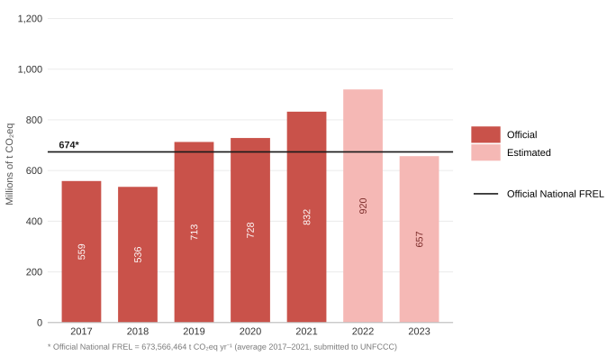

<div align="center">


[](http://dx.doi.org/10.5281/zenodo.3928660)
[](https://juleskreuer.eu/projekte/citation-badge/)

<br/>

# 🌿 Brazil National FREL
### Emissions from Deforestation and Forest Degradation

<br/>

> **Silva-Junior, C. H. L. et al. (2026)**
> *Increased deforestation and forest degradation jeopardize Brazil's REDD+ results in 2022*
> **Nature Communications**

<br/>

</div>

---

## 🌎 Overview

This repository provides the full computational pipeline used to replicate **Brazil's National Forest Reference Emission Level (FREL)** methodology and quantify greenhouse gas (GHG) emissions from deforestation and forest degradation across all six Brazilian biomes for 2017–2023.

The analysis follows the methodology submitted by Brazil to the **UNFCCC** and assessed under the **REDD+ results-based payments** framework, covering three disturbance types:

| Disturbance | Abbreviation | Biomes |
|---|---|---|
| Deforestation | `def` | All 6 biomes |
| Forest fire | `fire` | Amazon only |
| Unplanned selective logging | `sl` | Amazon only |

Greenhouse gases quantified: **CO₂**, **CH₄** (×GWP 28), and **N₂O** (×GWP 265), per IPCC AR5.

---

## 📊 Key Results

<div align="center">



**Figure 1.** Annual GHG emissions from deforestation and forest degradation across all six Brazilian biomes (millions of t CO₂eq yr⁻¹). Dark red = official FREL period (2017–2021); light pink = estimated emissions (2022–2023). The horizontal line marks the Official National FREL (673.6 Mt CO₂eq yr⁻¹) submitted to the UNFCCC.

</div>

### Emissions vs. Official National FREL — post-baseline years

| Year | Emissions (Mt CO₂eq) | FREL − Emissions (Mt CO₂eq) | FREL − Emissions (%) |
|:----:|---------------------:|----------------------------:|---------------------:|
| 2022 | 920.0 | **−246.4** | **−36.6 %** |
| 2023 | 656.9 | **+16.6** | **+2.5 %** |

> FREL baseline = 673.6 Mt CO₂eq yr⁻¹ (average 2017–2021). **Positive** = emissions below the reference level (eligible for REDD+ results-based payments); **negative** = emissions exceeded the reference level.

> [!NOTE]
> The chart (`figures/fig1_emissions_overview.svg`) is **auto-regenerated** by GitHub Actions whenever [`data/fig1_data.csv`](data/fig1_data.csv) is updated and pushed. To add a new year, append a row to that CSV and push — no manual editing of the figure required.

---

## 🖥️ System Requirements

### Software dependencies

| Software | Version tested | Notes |
|---|---|---|
| Google Earth Engine | Browser-based (2024) | Free account required: https://earthengine.google.com |
| R | ≥ 4.3.2 | https://cran.r-project.org |
| `ggplot2` | ≥ 3.4.0 | |
| `gridExtra` | ≥ 2.3 | |
| `showtext` | ≥ 0.9 | |
| `scales` | ≥ 1.2.1 | |
| `bsts` | ≥ 0.9.10 | |
| `dplyr` | ≥ 1.1.0 | |
| `openxlsx` | ≥ 4.2.5 | |
| `readr` | ≥ 2.1.4 | |

### Operating systems tested

- Windows 10 (64-bit)
- Ubuntu 22.04 LTS

### Non-standard hardware

No non-standard hardware is required. All GEE computations run on Google's cloud infrastructure. R scripts run on any standard desktop or laptop computer.

---

## ⚙️ Installation Guide

### Google Earth Engine

No local installation is required. GEE runs entirely in the browser.

1. Register for a free GEE account at https://earthengine.google.com (approval typically takes 1–2 business days)
2. Open the [GEE Code Editor](https://code.earthengine.google.com)
3. Copy and paste the contents of `codes/code_all_biomes_v1.js`

**Typical setup time:** < 5 minutes (after account approval).

### R

1. Install R (≥ 4.3.2) from https://cran.r-project.org
2. Install all required packages by running the following in an R console:

```r
install.packages(c(
  "ggplot2", "gridExtra", "showtext", "scales",
  "bsts", "dplyr", "openxlsx", "readr"
))
```

**Typical install time:** < 5 minutes on a standard desktop computer with internet connection.

---

## 🗺️ Study Biomes

Brazil's six biomes are modelled individually, each with its own carbon dataset, disturbance types, and combustion parameters:

<br/>

<div align="center">


</div>

<br/>

| Parameter | 🌳 **Amazon** | 🌾 **Cerrado** | 💧 **Pantanal** | 🌿 **Pampa** | 🏜️ **Caatinga** | 🌲 **Atlantic Forest** |
|:---|:---:|:---:|:---:|:---:|:---:|:---:|
| **Export prefix** | `amz` | `cerr` | `pan` | `pam` | `caa` | `ma` |
| **Deforestation** | ✅ CO₂ CH₄ N₂O | ✅ CO₂ CH₄ N₂O | ✅ CO₂ | ✅ CO₂ | ✅ CO₂ | ✅ CO₂ |
| **Fire** | ✅ CO₂ CH₄ N₂O | — | — | — | — | — |
| **Selective logging** | ✅ CO₂ | — | — | — | — | — |
| **Carbon data** | QCN + EBA/INPE | QCN | QCN | QCN | QCN | QCN |
| **Combustion fraction** | 0.368 | 0.379 | — | — | — | — |
| **PRODES classes** | >625 ha + <625 ha | >625 ha | >625 ha | >625 ha | >625 ha | >625 ha |
| **Annual exports** | 7 files/yr | 3 files/yr | 1 file/yr | 1 file/yr | 1 file/yr | 1 file/yr |

> **Total outputs:** 49 (Amazon) + 21 (Cerrado) + 7 × 4 (simple biomes) = **98 CSV files** per full run.

---

## 📁 Repository Structure

```
Brazil-National-FREL/
│
├── 📂 .github/workflows/
│   └── ⚙️  update_fig1.yml                    ← Auto-regenerates Figure 1 on CSV push
│
├── 📂 codes/
│   ├── 🌐 code_all_biomes_v1.js               ← GEE unified script (all 6 biomes)
│   ├── 📊 code_fig1_fig2_v1.R                 ← Publication figures (R)
│   └── 🔄 generate_fig1_svg.R                 ← Regenerates Figure 1 from data/fig1_data.csv
│
├── 📂 data/
│   ├── 📝 dataset_assets_gee.txt              ← GEE asset paths for all datasets
│   └── 📋 fig1_data.csv                       ← Figure 1 source data (editable)
│
├── 📂 figures/
│   └── 🖼️  fig1_emissions_overview.svg        ← Auto-generated chart (do not edit manually)
│
├── 📂 results/
│   ├── 🔧 join_tool_(gee_export_results)_v1.R ← Consolidates CSVs → Excel
│   └── 📂 Brazil-National-FREL-Results_V1/
│       ├── 📋 0_brazil_national_frel_results_v1.xlsx  ← Consolidated results
│       └── 📄 {biome}_emission_{dist}_{gas}_{year}.csv ← Raw outputs (98 files)
│
└── 📄 README.md
```

### Script descriptions

#### `codes/code_all_biomes_v1.js` — Unified GEE Script

Single script that processes all six biomes in one run. Configurable via a dedicated block at the top — change `START_YEAR`, `END_YEAR`, or `EXPORT_FOLDER` and the entire script adapts automatically:

```javascript
var START_YEAR    = 2017;         // First year (inclusive)
var END_YEAR      = 2023;         // Last year  (inclusive)
var EXPORT_FOLDER = 'Results_V1'; // Google Drive destination
```

#### `codes/code_fig1_fig2_v1.R` — Publication figures
R script that reads the consolidated Excel file and produces:
- **Figure 1** — Bootstrap analysis of emission differences (ΔE) with 95% CI
- **Figure 2** — Bayesian Structural Time Series (BSTS) forecast

#### `results/join_tool_(gee_export_results)_v1.R` — Results consolidator
Reads all 98 CSV files exported by GEE, parses the filename to extract metadata (biome, disturbance, gas, year), and writes a single consolidated Excel file with per-state emission values.

---

## 📊 Output File Naming Convention

Every CSV exported by the GEE script follows a standardised pattern:

```
{biome}_emission_{disturbance}_{gas}_{year}.csv
```

| Segment | Values | Example |
|---|---|---|
| `{biome}` | `amz` `cerr` `pan` `pam` `caa` `ma` | `amz` |
| `{disturbance}` | `def` `fire` `sl` | `fire` |
| `{gas}` | `co2` `ch4` `n2o` | `co2` |
| `{year}` | `2017` … `2023` | `2022` |

**Examples:**

| File | Biome | Disturbance | Gas | Year |
|---|---|---|---|---|
| `amz_emission_fire_co2_2022.csv` | 🌳 Amazon | Fire | CO₂ | 2022 |
| `amz_emission_sl_co2_2019.csv` | 🌳 Amazon | Selective logging | CO₂ | 2019 |
| `amz_emission_def_ch4_2020.csv` | 🌳 Amazon | Deforestation | CH₄ | 2020 |
| `cerr_emission_def_n2o_2021.csv` | 🌾 Cerrado | Deforestation | N₂O | 2021 |
| `pan_emission_def_co2_2023.csv` | 💧 Pantanal | Deforestation | CO₂ | 2023 |
| `ma_emission_def_co2_2022.csv` | 🌲 Atlantic Forest | Deforestation | CO₂ | 2022 |

Each CSV contains **per-state** emission sums (t CO₂e). The `sum` column holds the value; `NM_UF` = state name; `Bioma` = biome name.

---

## 🛰️ GEE Datasets

All data are accessed as GEE assets (no local download required):

| Dataset | Use |
|---|---|
| PRODES — deforestation >6.25 ha | Deforestation mask |
| PRODES — deforestation <6.25 ha | Small-patch deforestation (Amazon) |
| Managed Forest Lands | Fire mask (Amazon) |
| Biomes boundary (IBGE 1:250k) | Spatial clip |
| Ancient Forest Vegetation Map | Forest mask |
| Carbon AGB — Amazon (EBA/INPE, 30 m) | Carbon stock |
| Carbon BGB — Amazon (EBA/INPE, 30 m) | Carbon stock |
| Carbon Deadwood — Amazon (EBA/INPE, 30 m) | Carbon stock |
| Carbon Litter — Amazon (EBA/INPE, 30 m) | Carbon stock |
| QCN 30m — 4th National GHG Inventory | Carbon stock (all biomes) |
| Selective logging map — annual | Logging disturbance (Amazon) |
| Fire map — annual | Fire disturbance (Amazon) |
| States + Biomes boundary | Aggregation regions |

> Full GEE asset paths are listed in [`data/dataset_assets_gee.txt`](data/dataset_assets_gee.txt).

---

## ⚗️ Methodology Summary

Emissions are computed at 30 m resolution and aggregated by state × biome.

### Conversion factors

| Factor | Value | Source |
|---|---|---|
| C → CO₂ | 44 ÷ 12 ≈ **3.667** | Molecular weight ratio |
| GWP CH₄ | **28** | IPCC AR5 (100-year) |
| GWP N₂O | **265** | IPCC AR5 (100-year) |
| Amazon combustion fraction | **0.368** | Brazil National FREL |
| Cerrado combustion fraction | **0.379** | Brazil National FREL |
| Carbon to dry matter biomass | **1 / 0.47** ≈ 2.128 | Carbon fraction of dry biomass = 0.47 (Brazil National FREL) |

### Amazon carbon stock update order (per year)

```
t₀ stocks  →  [Fire emissions]  →  updated stocks
           →  [Selective logging emissions]  →  updated stocks
           →  [Deforestation emissions]  →  updated stocks  →  t+1
```

> [!IMPORTANT]
> The Amazon script processes disturbances **sequentially within each year**. Changing the order would alter results. The unified script preserves this exact sequence.

---

## 🚀 How to Use

### Step 1 — Run the GEE emissions script

1. Open the [GEE Code Editor](https://code.earthengine.google.com)
2. Copy and paste `codes/code_all_biomes_v1.js`
3. Edit the configuration block at the top if needed:

```javascript
var START_YEAR    = 2017;
var END_YEAR      = 2023;
var EXPORT_FOLDER = 'Results_V1';
```

4. Click **Run** — all export tasks will appear in the **Tasks** panel
5. Click **Run** on each task (or use the GEE batch API) to start the exports to Google Drive

> **Expected run time:** GEE script: 5–15 minutes (cloud-based; may vary with server load).

### Step 2 — Consolidate results (R)

```r
# Set file_path to where GEE exported the CSVs in Google Drive
source("results/join_tool_(gee_export_results)_v1.R")
# Output: results/Brazil-National-FREL-Results_V1/0_brazil_national_frel_results_v1.xlsx
```

> **Expected run time:** < 1 minute on a standard desktop computer.

### Step 3 — Generate publication figures (R)

```r
source("codes/code_fig1_fig2_v1.R")
# Output: Figure 1 (bootstrap ΔE) and Figure 2 (BSTS forecast)
```

> **Expected run time:** < 2 minutes on a standard desktop computer.

> [!NOTE]
> Required R packages: `ggplot2`, `gridExtra`, `showtext`, `scales`, `bsts`, `dplyr`, `openxlsx`, `readr`

### Expected outputs

Running Steps 1–3 in sequence reproduces all quantitative results reported in the manuscript, including:

- Estimated GHG emissions by biome and year (2017–2023) in t CO₂eq
- Bootstrap ΔE distributions for 2022 and 2023 (Figure 2 of the manuscript)
- BSTS counterfactual emission forecasts for 2022 and 2023 (Figure 3 of the manuscript)
- Consolidated Excel file with per-state emission values across all biomes and disturbance types

---

## 📖 Citation

If you use this code or data, please cite:

```bibtex
@article{silvajunior2026,
  author  = {Silva-Junior, Celso H. L. and others},
  title   = {Increased deforestation and forest degradation jeopardize
             {Brazil's} {REDD+} results in 2022},
  journal = {Nature Communications},
  year    = {2026},
  doi     = {}
}
```

---

## 📋 License

This project is licensed under the **GNU General Public License v4** — see the [LICENSE](LICENSE) file for details.

---

<div align="center">

Made with 🌿 for Brazilian forest conservation research

[](https://github.com/celsohlsj/Brazil-National-FREL)

</div>
